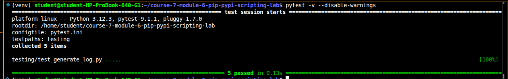

# Automation Tool

A lightweight Python automation tool that fetches data from a public API using the `requests` package and writes a dated log file. It runs from the command line and tracks its dependencies in `requirements.txt` so it can be reproduced in any environment.

## Features

- Fetches data from a public API with `requests` (installed via pip)
- `generate_log(log_data)` writes a list of entries to `log_YYYYMMDD.txt` using file I/O
- Raises a `ValueError` if the input is not a list
- Modular functions wrapped in an `if __name__ == "__main__":` block
- Dependencies tracked in `requirements.txt`

## Setup

1. Clone the repository:
```bash
   git clone https://github.com/sharonwanjiru417/course-7-module-6-pip-pypi-scripting-lab.git
   cd course-7-module-6-pip-pypi-scripting-lab
```
2. Create and activate a virtual environment:
```bash
   python3 -m venv venv
   source venv/bin/activate
```
3. Install dependencies:
```bash
   pip install -r requirements.txt
```

## Usage

```bash
python lib/generate_log.py
```

Example output:

```
Fetched Post Title: sunt aut facere repellat provident occaecati excepturi optio reprehenderit
Log written to log_20261022.txt
```

## Running the Tests

```bash
pytest -v
```

### Screenshot



## Project Structure

```
.
├── lib/
│   └── generate_log.py        # Main script
├── testing/
│   └── test_generate_log.py   # Tests
├── requirements.txt           # Dependencies
└── README.md
```

## Author

Sharon Wanjiru